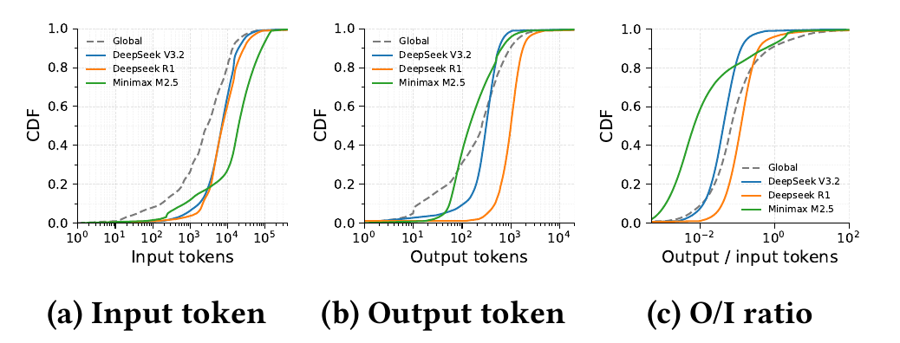
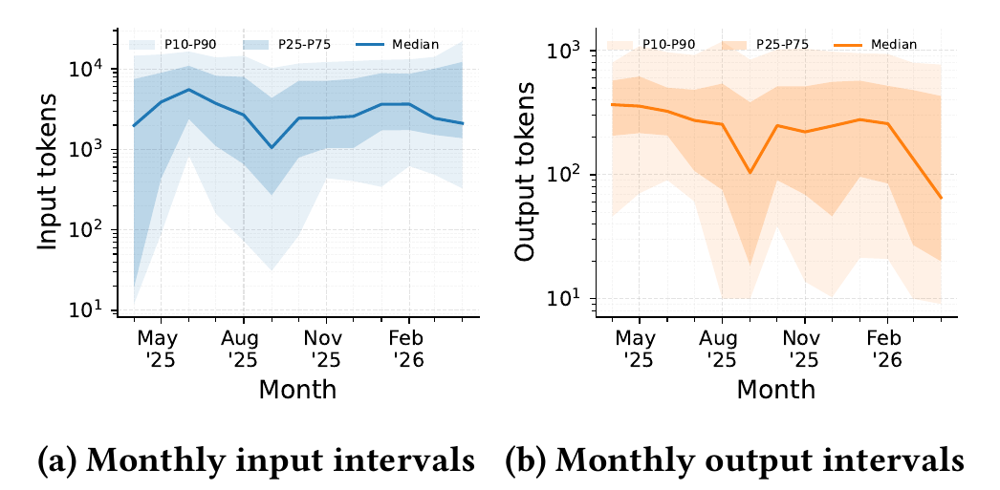
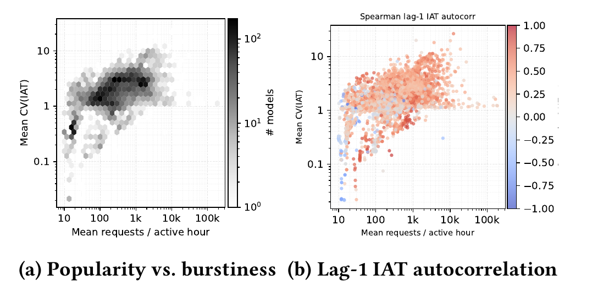
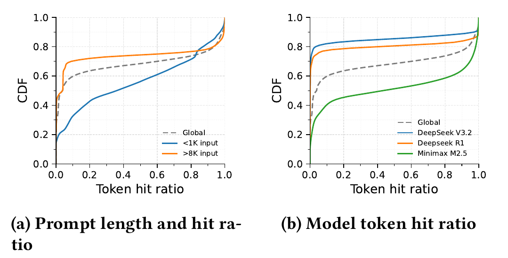
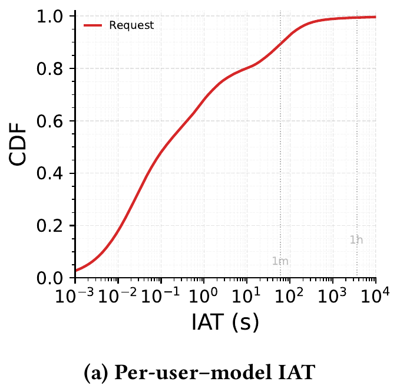
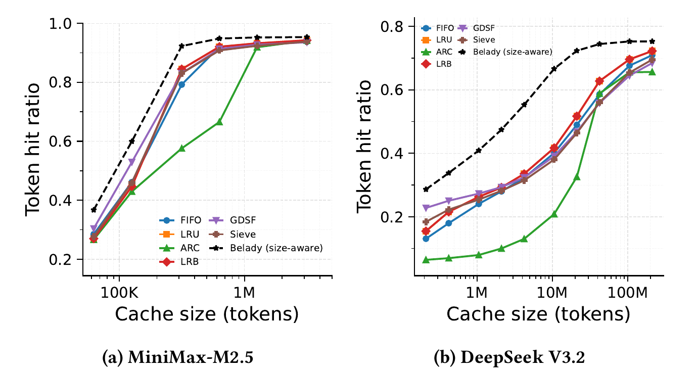
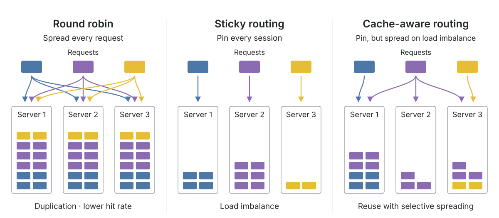
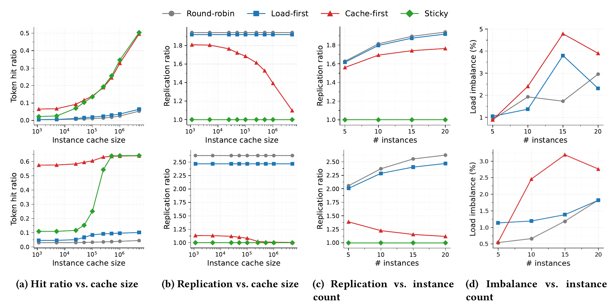

+++
title = 'A Year in LLM Serving: Workloads, Caching, and Routing'
date = 2026-10-12T00:00:00-05:00
author = 'William Nixon'
draft = false
tags = ['LLM', 'systems', 'serving', 'workloads', 'caching', 'load-balancing']
summary = 'An analysis of 6.12 billion production LLM requests, examining workload evolution, traffic patterns, prefix reuse, cache eviction, and request routing.'
+++

In our paper, [A Year in LLM Serving](https://arxiv.org/abs/2608.13573v2), we analyze **6.12 billion requests across 9,174 models and roughly 315,000 users**, collected from a full year of production traffic on [Chutes](https://chutes.ai/), from April 2025 to April 2026.

We characterize how LLM workloads evolve, examine model traffic and prefix reuse patterns, and evaluate their implications for KV-cache management and request routing.

Below, we summarize five key findings from our analysis.

## 1. Different models need different optimizations, and their workloads keep changing

Not all models behave the same way. MiniMax-M2.5, heavily used for coding and agentic tasks, typically receives long inputs but generates relatively short outputs. DeepSeek-R1, used for reasoning, tends to produce much longer responses.

These differences matter for serving systems. **Input-heavy workloads put more pressure on prefill, while output-heavy workloads spend more time decoding.** An optimization that works well for one model may be less effective for another.

*Figure 1. Different models have different input and output characteristics. MiniMax-M2.5 is more input-heavy, while DeepSeek-R1 generates longer outputs.*

But even the same workloads don't stay the same over time. Across the year, median input lengths remained relatively stable, while median output lengths dropped from a few hundred tokens to below 100. Model popularity also shifted substantially, with traffic spreading across more models.

*Figure 2. Input lengths remain broadly stable, while output lengths become shorter over the year. Lines indicate medians; shaded regions show percentile ranges.*

**Implications:** Serving systems should adapt to both model-specific characteristics and changing workload patterns. Static optimizations tuned to today's popular models may become less effective as workloads evolve.

## 2. Model traffic comes in bursts, creating opportunities for GPU sharing

The dataset covers thousands of models, from popular public models to privately deployed fine-tuned models. We found that **most models exhibit bursty traffic**, with periods of intense activity followed by relatively quiet periods.

Interestingly, many models also show positive correlations between consecutive inter-arrival times. In other words, busy periods tend to remain busy, while quiet periods tend to persist.

*Figure 3. Most models exhibit uneven request arrivals, and many show correlated busy and quiet periods.*

**Implications:** These patterns create opportunities for model colocation. Rather than dedicating GPUs to models that may sit idle much of the time, serving systems could colocate models with complementary demand patterns to improve utilization. Understanding model popularity and burstiness can help guide placement and resource allocation.

## 3. Prefix reuse is often all-or-nothing, and most repeat requests arrive quickly

Prefix caching avoids recomputing previously processed prompts by retaining their KV-cache state. For workloads with long inputs, this can save substantial prefill computation.

We found something interesting: **requests often reuse almost their entire input prefix or almost none of it.** Partial reuse is much less common.

Reuse also differs substantially across models. MiniMax-M2.5 exhibits more reuse than the DeepSeek models in our analysis, consistent with coding and agentic workloads that repeatedly extend previous contexts.

*Figure 4. Cache reuse is often close to either zero or complete reuse. The amount of reuse also differs across models and prompt lengths.*

Another important question is how long cached prefixes should stay in memory.

Looking at consecutive requests from the same user to the same model, we found that **approximately 50% arrive within 0.1 seconds, 80% within 10 seconds, and 99% within 15 minutes.**

*Figure 5. Repeat requests arrive quickly: approximately 50% within 0.1 seconds, 80% within 10 seconds, and 99% within 15 minutes. These are repeat arrivals, not guaranteed cache hits.*

**Implications:** LLM workloads exhibit strong temporal locality. Short cache-retention windows can capture much of the potential reuse without keeping stale prefixes in memory for hours. Cache management should prioritize recently active prefixes rather than retaining everything indefinitely.

## 4. Simple cache eviction policies are surprisingly hard to beat

With limited GPU memory, serving systems must decide which cached prefixes to keep and which to evict. But how sophisticated does the eviction policy really need to be?

We simulated several eviction policies and found that **simple policies like FIFO and LRU often match or outperform more complex alternatives** in our evaluated workloads.

One possible explanation is the strong temporal locality we observed earlier. When most reuse happens shortly after a previous request, simple policies can already capture a large fraction of reusable prefixes.

*Figure 6. FIFO and LRU are competitive with more sophisticated eviction policies across the evaluated workloads. The future-aware Belady oracle indicates the remaining room for improvement.*

**Implications:** FIFO and LRU are strong baselines for KV-cache eviction. However, a gap remains between these policies and the future-aware Belady oracle. Closing this gap may require richer workload information, such as user access patterns and session context, beyond simple recency or frequency.

## 5. A good cache policy isn't enough: request routing matters too

Even the best eviction policy cannot help if requests are sent to the wrong server.

In multi-instance serving, each server maintains its own KV cache. When related requests are routed to different servers, reusable prefixes may need to be recomputed and stored multiple times.

This creates an important tradeoff between **cache reuse and load balancing**.

We compare three routing approaches:

- **Round-robin and least-load routing** distribute requests across servers, but can reduce cache locality and cause cache duplication.
- **Sticky routing** keeps requests from the same session on one server, improving reuse but potentially creating load imbalance.
- **Cache-aware routing** sends requests to the server holding the largest reusable prefix, improving reuse at the cost of some load imbalance.

*Figure 7. Round-robin spreads every request. Sticky routing pins each session to one server. Cache-aware routing follows cached prefixes while allowing work to spread when needed for load balancing. This is an explanatory schematic.*

We evaluated these approaches using fleet-level simulations of production workloads.

**Cache-aware routing consistently improves cache reuse and reduces session spread**, meaning fewer servers need to handle requests from the same session. The tradeoff is a modest increase in load imbalance compared with routing strategies focused purely on distributing requests.

Another interesting finding is that **increasing cache capacity alone does not guarantee better reuse**. If requests keep arriving at servers that don't hold their prefixes, extra cache space may do little to help.

*Figure 8. Cache-aware routing achieves higher cache hit ratios and reduces session spread, with a modest increase in load imbalance.*

**Implications:** Cache management and request routing should be optimized together. Increasing cache capacity or improving eviction alone may not be enough; serving systems must also route requests toward reusable prefixes while keeping the fleet reasonably balanced.

## Paper and Dataset

This is part of our ongoing effort to release real-world LLM serving datasets through [FreeInference Open Data](https://data.freeinference.org/), covering production request traces, agentic workloads, and GPU telemetry.

We've made the full one-year Chutes trace, paper, and analysis code publicly available:

- **Paper:** [A Year in LLM Serving](https://arxiv.org/abs/2608.13573v2)
- **Code and analysis:** [GitHub repository](https://github.com/HarvardMadSys/chutes_workload)
- **Download dataset:** [Hugging Face](https://huggingface.co/datasets/harvardMadsys/chutes_metadata)

Feel free to check out this dataset and our other releases! We hope they'll be useful for your own research, and we'd love to see what you build with them.