+++

title = 'From Requests to Sessions: Workload characterization of Agentic Workloads'
date = 2026-11-04T00:00:00-05:00
author = 'William Nixon'

draft = false

tags = ['LLM', 'agents', 'systems', 'serving', 'workloads', 'caching']

summary = 'Our takeaways from analyzing coding-agent traffic from FreeInference.'

+++

In our paper, [From Requests to Sessions: A Large-Scale Characterization of Human-Driven Agentic Workloads](https://data.agentic-system.org/pdf/paper/from-requests-to-sessions.pdf), we analyze **3.7 months of production coding-agent traffic from [FreeInference](https://freeinference.org/)**. The trace contains roughly **12,000 sessions, 1.2 million LLM requests, and 209 billion input tokens** across 13 agent harnesses, alongside a separate SWE-Bench replay.

We study how agents interact with LLMs and tools, how their contexts grow, and what these patterns mean for serving latency, caching, and cost. The findings below focus on human-driven production sessions unless otherwise noted.

Here are six key takeaways from our analysis.

## 1. Although priced cheaply, cached tokens dominate session cost.

Coding agents repeatedly send their growing context with each LLM request. Most of these input tokens are reused through prefix caching, which avoids recomputation. However, reading cached tokens still incurs a cost, and that cost adds up over repeated requests.

The median request contains about **129,000 input tokens, with only about 500 uncached**. Outputs are much shorter, at roughly 200 tokens. In other words, each request introduces relatively little new prefill and decoding work.

As a result, **cached input accounts for 97.4% of input-token volume and 72.9% of modeled API cost** among requests with reported cache usage. Although cached tokens are much cheaper individually, their enormous volume makes them the largest contributor to cost. Our analysis uses reference prices of 1 per million cached input tokens, 10 per million fresh input tokens, and 50 per million output tokens.



  <figure class="fig-plot">
    
Tokens per request

    

      <i class="fig-key fig-key--blue"></i>Input
      <i class="fig-key fig-key--red"></i>Uncached input
      <i class="fig-key fig-key--green"></i>Output
    

    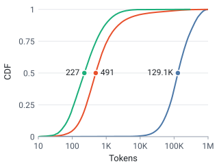
  </figure>
  <figure class="fig-plot">
    
Modeled cost by session

    

      <i class="fig-key fig-key--box fig-key--blue"></i>Cached input
      <i class="fig-key fig-key--box fig-key--red"></i>Uncached input
      <i class="fig-key fig-key--box fig-key--green"></i>Output
    

    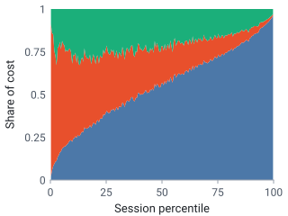
  </figure>



**Implications:** **Serving systems** should optimize the cost of serving cache hits, not just reducing cache misses. **Agent harnesses** should focus on reducing unnecessary LLM–tool steps, since each additional request may reread hundreds of thousands of cached tokens. **Users** should pay closer attention to cache-read pricing when comparing models, rather than looking only at input and output token prices.

## 2. Tools are the main bottleneck in active sessions, while user idle time dominates overall session duration.

Coding agents alternate between LLM inference, tool execution, and waiting for users. Faster inference only improves part of this process.

On average, user idle time accounts for **50.3% of session duration**, followed by tools at **21.7%**, decode at **18.1%**, and prefill at **9.9%**. For externally routed models, queueing and other provider overheads can also contribute substantially to time before the first token.

We simulated the effect of halving the time spent on each component. Excluding user idle time and capping tool gaps at 15 minutes, **halving tool time produces a 1.38× speedup**, compared with **1.09× for prefill** and **1.16× for decode**.



  <i class="fig-key fig-key--box fig-key--blue"></i>Prefill
  <i class="fig-key fig-key--box fig-key--amber"></i>Decode
  <i class="fig-key fig-key--box fig-key--green"></i>Tool
  <i class="fig-key fig-key--box fig-key--red"></i>User idle

  <figure class="fig-plot">
    
Where session time goes

    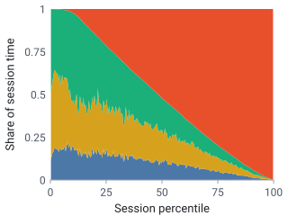
  </figure>
  <figure class="fig-plot">
    
Speedup if one part is 2× faster

    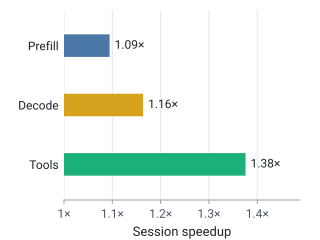
  </figure>



**Implications:** Faster LLM inference alone may not translate into much faster agents. **Agent harnesses** should prioritize lower-latency tools, reduce unnecessary tool calls, and request user clarification early, potentially asynchronously. **Serving systems** should reduce queueing delays through better scheduling and load balancing, while **hardware and runtime designers** should pay more attention to tool-execution workloads.

## 3. Tool parallelism is underused, and subagents wait for stragglers

Many tool calls can run independently, but agents often execute them one at a time. We found that **84.5% of tool-calling requests issue only one tool call**, even though batching appears in many sessions.

Batching independent calls can avoid repeated model–tool round trips. In our analysis, observed batched latency remains relatively flat as the number of calls grows, while a projected serial execution path becomes longer.



  <figure class="fig-plot">
    
Step latency by batch size

    

      <i class="fig-key fig-key--gray fig-key--dash"></i>Serial calls (projected)
      <i class="fig-key fig-key--green"></i>Batched (median)
      <i class="fig-key fig-key--box" style="--c: rgb(27 175 122 / .28)"></i>25th–75th
      <i class="fig-key fig-key--box" style="--c: rgb(27 175 122 / .12)"></i>10th–90th
    

    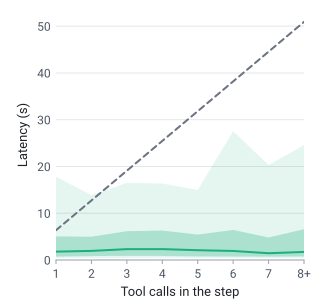
  </figure>
  <figure class="fig-plot">
    
Calls per request, by tool

    

      <i class="fig-key fig-key--box fig-key--gray"></i>Native tool
      <i class="fig-key fig-key--box fig-key--amber"></i>Shell command
    

    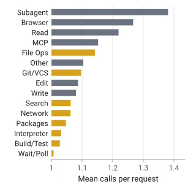
  </figure>



Subagents introduce a related challenge. Only **10.4% of sessions use subagents**, and **67% of subagent calls are synchronous**, leaving the parent waiting. When several subagents run together, the slowest can take more than **5×** as long as the fastest. Tool execution contributes much of this imbalance.



  <i class="fig-key fig-key--box fig-key--blue"></i>Slowest ÷ fastest sibling
  <i class="fig-key fig-key--box fig-key--red"></i>Slowest ÷ median sibling

  <figure class="fig-plot">
    
Imbalance by metric

    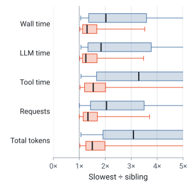
  </figure>
  <figure class="fig-plot">
    
Wall-time imbalance by task split

    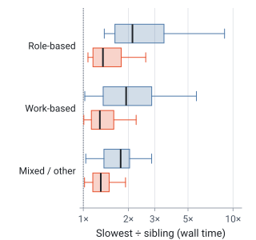
  </figure>



**Implications:** **Agent harnesses** should execute independent tool calls in parallel rather than making repeated LLM round trips. For subagents, simply spawning more workers is not enough: work should be divided more evenly, with heavier tasks started earlier to reduce stragglers. **Serving systems and harnesses** could also coordinate subagent execution and inference scheduling to reduce time spent waiting for the slowest worker.

## 4. Context mutations are costly, but sometimes necessary

Although coding-agent contexts typically grow by appending new messages, we find that context mutations, where previously generated context is modified or removed, are quite common across sessions.

Mutations occur in only 4% of step transitions, but **56.4% of sessions experience at least one**. Under infinite cache retention, mutations account for **62.5% of fresh prefill tokens**. This is because even a small change near the beginning of a prompt can invalidate the cached prefix, forcing much of the context to be processed again.

Interestingly, avoiding mutations is not always better. In our what-if analysis, **eliminating context reductions actually increases fresh prefill** tokens by about 5% with 15-minute cache retention. Without these reductions, contexts continue to grow, making future cache misses more expensive. Longer contexts also increase the cost of repeated cache reads, even when caching succeeds.



  <figure class="fig-plot">
    
Context transitions

    <table class="d-mut">
      <thead><tr><th>Transition</th><th>Steps%</th><th>Sessions%</th><th>Prefill%</th></tr></thead>
      <tbody>
        <tr><td>Append</td><td>96.00</td><td>43.6</td><td>37.5</td></tr>
        <tr class="d-mut-total"><td>Mutation</td><td>4.00</td><td>56.4</td><td>62.5</td></tr>
        <tr class="d-mut-cause"><td>Injection</td><td>0.96</td><td>17.1</td><td>7.4</td></tr>
        <tr class="d-mut-cause"><td>System prompt</td><td>0.74</td><td>20.3</td><td>26.9</td></tr>
        <tr class="d-mut-cause"><td>Tool definitions</td><td>0.40</td><td>21.4</td><td>13.9</td></tr>
        <tr class="d-mut-cause"><td>Dropped turns</td><td>0.36</td><td>6.5</td><td>5.3</td></tr>
        <tr class="d-mut-cause"><td>Compaction</td><td>0.04</td><td>3.7</td><td>0.6</td></tr>
        <tr class="d-mut-cause"><td>Tool result drop</td><td>0.51</td><td>5.9</td><td>3.2</td></tr>
        <tr class="d-mut-cause"><td>Other</td><td>1.00</td><td>14.5</td><td>5.2</td></tr>
      </tbody>
    </table>
  </figure>
  <figure class="fig-plot">
    
Cache hit ratio after the step

    

      <i class="fig-key fig-key--green"></i>Append
      <i class="fig-key fig-key--red"></i>Mutation
    

    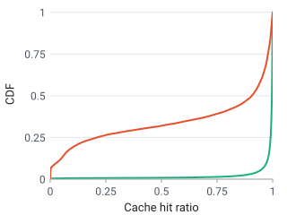
  </figure>



Implications: **Agent harnesses and serving systems** should be designed with prefix reuse in mind. Harnesses should keep stable instructions and tool definitions consistent to avoid unnecessary cache invalidation. **Users** should use context reductions strategically to control context growth and future cache-read and miss costs.

## 5. The need of session level hints to guide better prefix retention policies

Coding-agent sessions alternate between rapid LLM–tool interactions and long pauses while users review results or decide what to do next. A typical session lasts about **30 minutes**, but an individual user turn lasts only about **61 seconds**.

These phases have very different timing characteristics. The median gap between tool steps is just **1.8 seconds**, compared to **96.5 seconds between user turns**. This also affects cache reuse: mean cache hit ratios remain near **97.5% after tool steps**, but drop to **84% after user pauses**. Longer pauses make it harder to keep previously cached contexts available.



  <i class="fig-key fig-key--green"></i>Tool gap
  <i class="fig-key fig-key--amber"></i>Ask-user tool
  <i class="fig-key fig-key--red"></i>User idle
  <i class="fig-key fig-key--blue"></i>Subagent

  <figure class="fig-plot">
    
Gap before the next request

    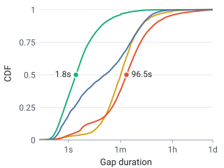
  </figure>
  <figure class="fig-plot">
    
Cache hit ratio after the gap

    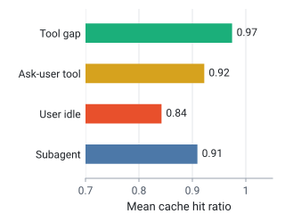
  </figure>



One way to improve reuse is to retain cached KV state for longer. However, **longer retention comes at a significant storage cost**. Retaining cached state for roughly a day captures nearly all potential temporal reuse, but requires **25.6× more mean storage than 15-minute retention**. Much of this extra storage holds prefixes that will never be reused, such as those from completed sessions or discarded contexts.



  <figure class="fig-plot">
    
User API cost

    

      <i class="fig-key fig-key--box fig-key--green"></i>Output
      <i class="fig-key fig-key--box fig-key--blue"></i>Cache reads
      <i class="fig-key fig-key--box fig-key--red"></i>Uncached input
    

    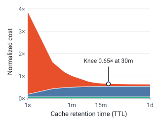
  </figure>
  <figure class="fig-plot">
    
Provider cost

    

      <i class="fig-key fig-key--box fig-key--red"></i>Recompute
      <i class="fig-key fig-key--box fig-key--yellow"></i>Storage
    

    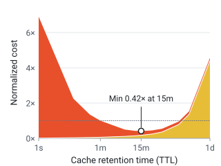
  </figure>



**Implications:** **Cache management should be session-aware, rather than simply keeping everything longer.** Active tool loops benefit from retaining KV state, while longer user pauses may call for offloading or different retention decisions. **Agent harnesses** could expose signals when session pause, finish or context is mutated, allowing **serving systems** to distinguish between active and inactive sessions, and manage cache accordingly. This could improve reuse without the high memory overhead of long retention.

## 6. Benchmark agents are easier to cache than production agents

Most coding-agent benchmarks, such as SWE-Bench, give an agent a well-defined task and let it work toward a solution. However, real users interact with agents differently. They often provide shorter instructions, ask follow-up questions, and leave long pauses between interactions. These differences can significantly affect caching behavior.

Compared with our SWE-Bench replay, **production sessions last 9.4× longer and carry 5.1× more input tokens per request**. The median production session lasts about **30 minutes, compared to just 3.2 minutes** in the benchmark. Similarly, the median request contains roughly **129,000 input tokens, compared to 25,000**.

These differences also affect how long cached contexts need to be retained. In the benchmark replay, a **5-minute cache-retention window** is enough to bring fresh prefill within 3% of the infinite-retention minimum. In production, however, **a one-day retention window** is needed to reach the same range among the windows we evaluated. The benchmark replay also lacks the context mutations observed in production, which can further disrupt prefix reuse.



  <i class="fig-key fig-key--blue"></i>Human-driven
  <i class="fig-key fig-key--amber"></i>Benchmark (SWE-Bench replay)

  <figure class="fig-plot">
    
Session duration

    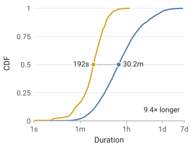
  </figure>
  <figure class="fig-plot">
    
Input tokens per request

    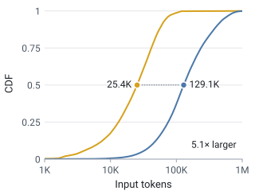
  </figure>



**Implications:** **Benchmark-only evaluations may overestimate how effectively serving systems can cache agent workloads.** Real users create longer sessions, larger contexts, and unpredictable idle periods that are not well represented by benchmark replays. Serving systems should therefore be evaluated using realistic production traces that capture user pauses, follow-up interactions, and context mutations, rather than relying on benchmarks alone.

## Paper and Dataset

This work is part of our ongoing effort to release real-world LLM serving datasets through [FreeInference Open Data](https://data.freeinference.org/), including general inference traces, agentic workloads, and GPU telemetry.

Check out our [interactive session explorer](https://agent-traces.freeinference.org/) or use the public data for your own research:

- **Paper:** [From Requests to Sessions](https://data.agentic-system.org/pdf/paper/from-requests-to-sessions.pdf)

- **Code and analysis:** [GitHub repository](https://github.com/HarvardMadSys/freeinference_agentic_trace)

- **Download dataset:** [Hugging Face](https://huggingface.co/datasets/harvardMadsys/freeinference_agentic_trace)

- **Dataset collection:** [FreeInference Open Data](https://data.freeinference.org/)

Feel free to check out this dataset and our other releases! We hope they will be useful for your research, and we'd love to see what you build with them.
