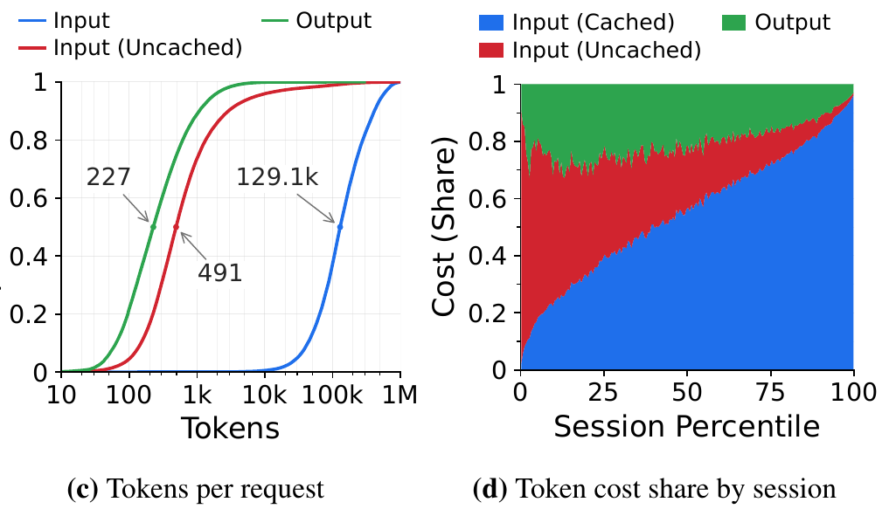
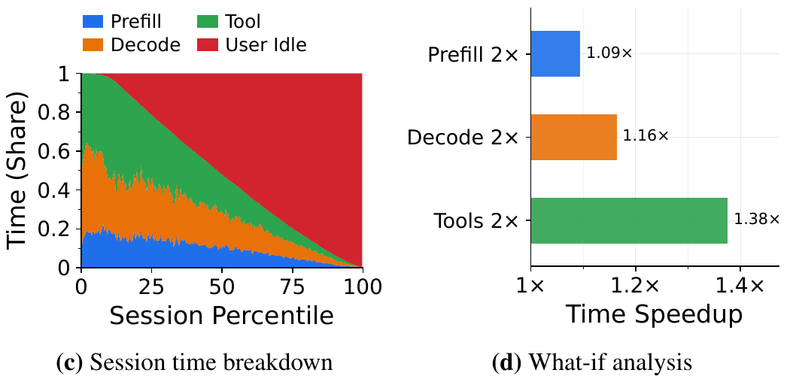
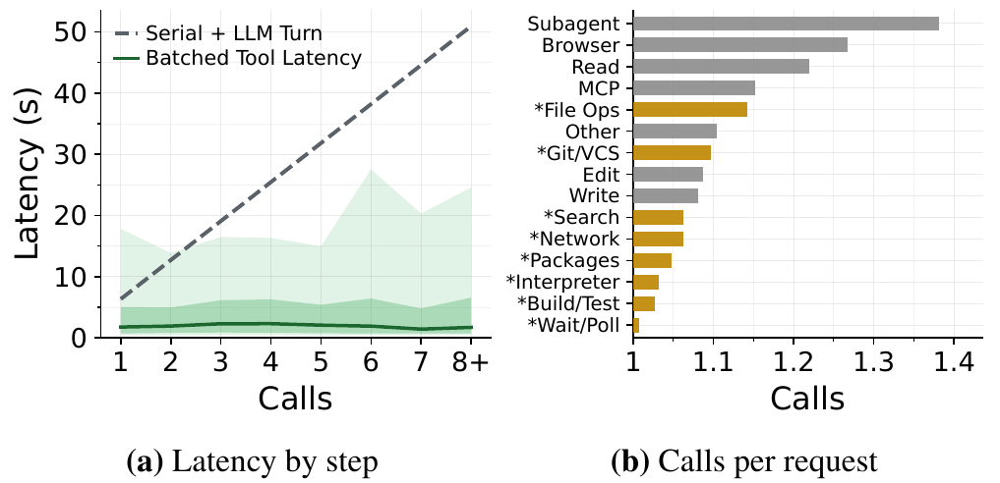
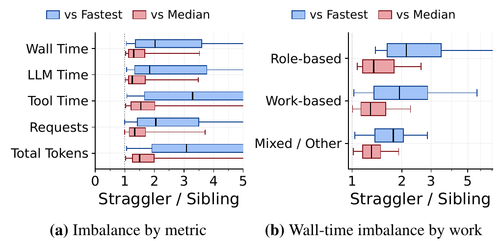
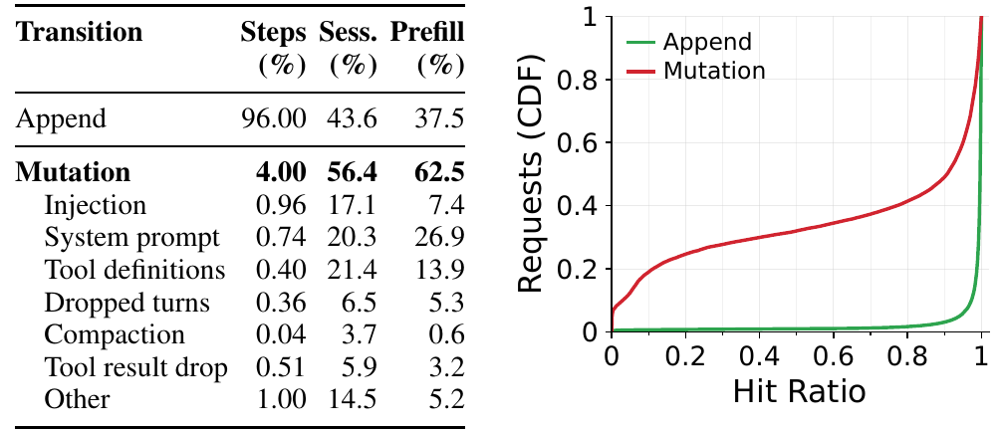
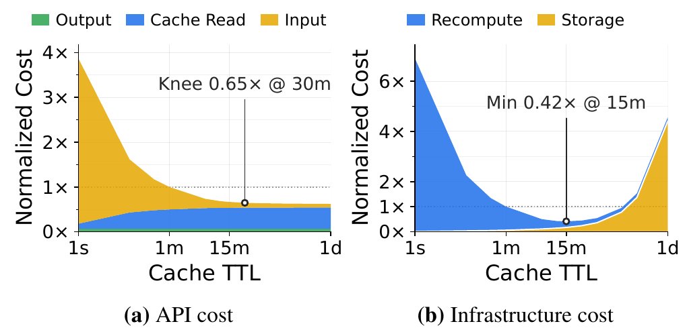
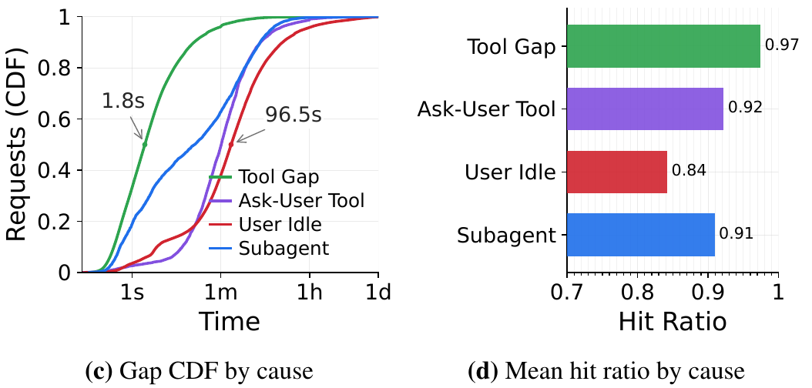
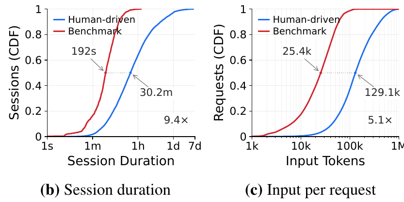

+++

title = 'From Requests to Sessions: Workload characterization of Agentic Workloads'

author = 'William Nixon'

draft = true

tags = ['LLM', 'agents', 'systems', 'serving', 'workloads', 'caching']

summary = 'Production coding-agent traces reveal growing context costs, tool bottlenecks, cache-retention tradeoffs, and why serving systems need to understand sessions rather than isolated requests.'

+++

In our paper, [From Requests to Sessions: A Large-Scale Characterization of Human-Driven Agentic Workloads](https://data.agentic-system.org/pdf/paper/from-requests-to-sessions.pdf), we analyze **3.7 months of production coding-agent traffic from [FreeInference](https://freeinference.org/)**. The trace contains roughly **12,000 sessions, 1.2 million LLM requests, and 209 billion input tokens** across 13 agent harnesses, alongside a separate SWE-Bench replay.

We study how agents interact with LLMs and tools, how their contexts grow, and what these patterns mean for serving latency, caching, and cost. The findings below focus on human-driven production sessions unless otherwise noted.

Here are seven key takeaways from our analysis.

## 1. Although priced cheaply, cached tokens dominate session cost.

Coding agents repeatedly send the model their growing history of instructions, messages, and tool results. Prefix caching lets the provider reuse previously computed KV-cache state. These reused tokens are cheaper than fresh input tokens, but reading them still has a cost.

The median request contains about **129,000 input tokens, with only about 500 uncached**. Outputs are much shorter, at roughly 200 tokens. Most input tokens come from carrying previous context forward.

Among requests with reported cache usage, **cached input accounts for 97.4% of input-token volume and 72.9% of modeled API cost**. Our cost analysis uses reference prices of $1 per million cached input tokens, $10 per million fresh input tokens, and $50 per million output tokens.

*Figure 1. Requests carry long inputs with little new text. Repeated cache reads account for most modeled session cost.*

**Implications:** **Serving systems** should optimize the cost of serving cache hits, not just reducing cache misses. **Agent harnesses** should focus on reducing unnecessary LLM–tool steps, since each additional request may reread hundreds of thousands of cached tokens. **Users** should pay closer attention to cache-read pricing when comparing models, rather than looking only at input and output token prices.

## 2. Tools are the main bottleneck in active sessions, while user idle time dominates overall session duration.

Coding agents alternate between LLM inference, tool execution, and waiting for users. Faster inference only improves part of this process.

On average, user idle time accounts for **50.3% of session duration**, followed by tools at **21.7%**, decode at **18.1%**, and prefill at **9.9%**. For externally routed models, queueing and other provider overheads can also contribute substantially to time before the first token.

We simulated the effect of halving the time spent on each component. Excluding user idle time and capping tool gaps at 15 minutes, **halving tool time produces a 1.38× speedup**, compared with **1.09× for prefill** and **1.16× for decode**.

*Figure 2. Tool acceleration provides the largest active-session speedup in this what-if analysis. User idle time is excluded and tool gaps are capped at 15 minutes.*

**Implications:** Faster LLM inference alone may not translate into much faster agents. **Agent harnesses** should prioritize lower-latency tools, reduce unnecessary tool calls, and request user clarification early, potentially asynchronously. **Serving systems** should reduce queueing delays through better scheduling and load balancing, while **hardware and runtime designers** should pay more attention to tool-execution workloads.

## 3. Tool parallelism is underused, and subagents wait for stragglers

Many tool calls can run independently, but agents often execute them one at a time. We found that **84.5% of tool-calling requests issue only one tool call**, even though batching appears in many sessions.

Batching independent calls can avoid repeated model–tool round trips. In our analysis, observed batched latency remains relatively flat as the number of calls grows, while a projected serial execution path becomes longer.

*Figure 3. Batching independent tools avoids repeated model–tool round trips. Serial latency is projected; batched latency comes from the trace.*

Subagents introduce a related challenge. Only **10.4% of sessions use subagents**, and **67% of subagent calls are synchronous**, leaving the parent waiting. When several subagents run together, the slowest can take more than **5×** as long as the fastest. Tool execution contributes much of this imbalance.

*Figure 4. Parallel subagents can be limited by the slowest child. Tool time shows the largest imbalance, while role-based assignments are less balanced than work-based assignments.*

**Implications:** **Agent harnesses** should execute independent tool calls in parallel rather than making repeated LLM round trips. For subagents, simply spawning more workers is not enough: work should be divided more evenly, with heavier tasks started earlier to reduce stragglers. **Serving systems and harnesses** could also coordinate subagent execution and inference scheduling to reduce time spent waiting for the slowest worker.

## 4. Small context changes can cause large cache misses

Prefix caching relies on an unchanged beginning of the prompt. Rewriting system instructions, changing tool definitions, or removing earlier messages can break that prefix. We call these changes **context mutations**.

Mutations occur in only **4% of step transitions**, but **56.4% of sessions** have at least one. Under infinite cache retention, mutations account for **62.5% of fresh prefill tokens**. Even a small change near the start of a prompt can force much of the context to be processed again.

However, avoiding every mutation is not necessarily better. Removing old history can make later requests shorter, reducing the cost of repeated cache reads. In a what-if analysis, eliminating context reductions can increase fresh prefill by about **5% with 15-minute cache retention**.

*Figure 5. Relatively rare context changes account for a large share of fresh prefill. Changes near the start of a prompt can disrupt reuse of much of the context.*

**Implications:** **Agent harnesses and serving systems should be co-designed with prefix reuse in mind.** Harnesses should keep stable instructions and tool definitions consistent to avoid unnecessary cache invalidation. However, avoiding all context mutations is not the answer: compaction may cause a cache miss now but reduce future cache-read costs. The goal should be to minimize **total serving cost, not simply maximize cache hit ratio**.

## 5. Longer cache retention helps, until storage costs take over

Coding-agent sessions can pause while users review results and resume minutes or hours later. Keeping KV-cache state avoids recomputing earlier context, but it also consumes memory.

In our simulations, **15-minute retention minimizes the provider's combined cost of recomputation and storage** under the evaluated infrastructure model. From the user's perspective, **30-minute retention brings modeled API cost within 4% of its minimum**.

Retaining state for roughly a day captures nearly all potential temporal reuse, but requires **25.6× the mean storage** of 15-minute retention. Most of that excess storage holds dead prefixes that are never reused from completed sessions or mutations.

*Figure 6. Longer retention reduces fresh prefill and user cost, but provider storage costs eventually dominate. Costs are normalized to a one-minute retention time.*

**Implications:** **Keeping caches longer is not always better.** A short retention window provides a strong baseline, but fixed TTLs cannot distinguish useful prefixes from dead state. **Agent harnesses** could expose signals when sessions finish or contexts are discarded, allowing **serving systems** to reclaim unused KV state early while retaining potentially reusable prefixes longer. This could improve reuse without the high memory overhead of long retention.

## 6. Agent sessions alternate between fast tool loops and long user pauses

A typical coding-agent session lasts about **30 minutes**, while an individual user turn lasts about **61 seconds**. Agents make repeated LLM and tool calls, then often wait while the user reviews results or decides what to do next.

The median gap between ordinary tool steps is about **1.8 seconds**, compared with **96.5 seconds for user idle gaps**. Mean cache hit ratios remain near **97.5%** after ordinary tool gaps but fall to **84%** after user pauses.

*Figure 7. Requests return quickly during tool loops, while longer user pauses are associated with lower cache reuse.*

**Implications:** **Cache management should be session-aware rather than treating every request independently.** Active tool loops benefit from keeping KV state readily available, while longer user pauses may call for offloading or different retention decisions. Harnesses could expose session activity signals so serving systems know when to retain, prefetch, offload, or release cached state. A quiet session should not automatically be treated as a completed one.

## 7. Benchmark agents are easier to cache than production agents

Benchmarks such as SWE-Bench typically give an agent one detailed issue and let it work toward a solution. Human-driven sessions often involve shorter instructions, repeated follow-ups, and longer pauses. These differences change how much context must be retained and for how long.

Compared with our SWE-Bench replay, **production sessions last 9.4× longer and have 5.1× more input tokens per request**. Median session duration is about **30 minutes versus 3.2 minutes**, while median input length is roughly **129,000 versus 25,000 tokens**.

A **5-minute retention window** brings the benchmark replay's prefill within 3% of its infinite-retention minimum. Among the retention windows evaluated, production first reaches that range at **one day**. The benchmark replay also lacks the context mutations observed in production.

*Figure 8. Production sessions last longer and carry larger contexts than the benchmark replay, creating different cache-retention requirements.*

**Implications:** **Benchmark-only evaluations may give an overly optimistic picture of agent-serving performance.** Real users create longer sessions, larger contexts, and unpredictable pauses that are largely absent from benchmark replays. Serving systems should be evaluated with realistic production traces, including user idle time, follow-up turns, and context mutations, to avoid underestimating cache and memory requirements.

## Paper and Dataset

This work is part of our ongoing effort to release real-world LLM serving datasets through [FreeInference Open Data](https://data.freeinference.org/), including general inference traces, agentic workloads, and GPU telemetry.

Check out our [interactive session explorer](https://agent-traces.freeinference.org/) or use the public data for your own research:

- **Paper:** [From Requests to Sessions](https://data.agentic-system.org/pdf/paper/from-requests-to-sessions.pdf)

- **Code and analysis:** [GitHub repository](https://github.com/HarvardMadSys/freeinference_agentic_trace)

- **Download dataset:** [Hugging Face](https://huggingface.co/datasets/harvardMadsys/freeinference_agentic_trace)

- **Dataset collection:** [FreeInference Open Data](https://data.freeinference.org/)

Feel free to check out this dataset and our other releases! We hope they will be useful for your research, and we'd love to see what you build with them.
